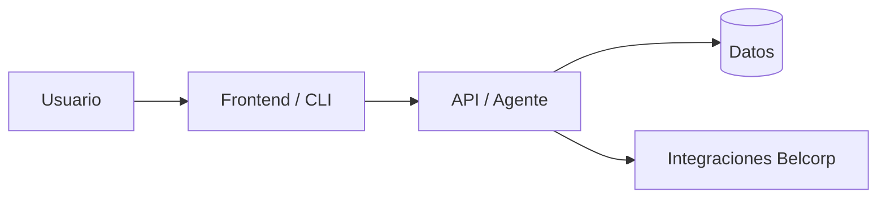
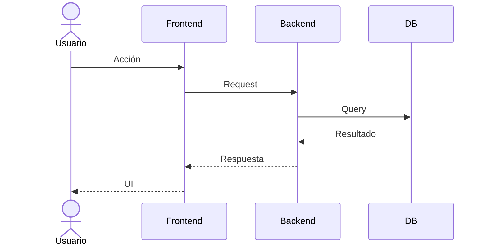

# Plantilla · Arranque de proyecto (validación + SRS corto)

> Copiar a `docs/projects/<slug>/SRS.md` al iniciar cualquier proyecto nuevo. Objetivo: 1 página legible,
> no un documento ceremonial.

## 0. Validación de idea (lo hace `explorer` / `researcher` antes de escribir código)

- [ ] Problema real descrito por un usuario real (no "sería cool si…").
- [ ] 3+ fuentes revisadas (docs oficiales, benchmarks, repos de referencia). Lista con enlace.
- [ ] Alternativas consideradas y descartadas (buy vs. build vs. reuse).
- [ ] Riesgos técnicos conocidos listados.
- [ ] Veredicto: **viable / viable con cambios / no viable**. Justificar en 2 líneas.

## 1. Problema

Una frase. Sin jerga.

## 2. Usuarios y job-to-be-done

- Primario: …
- Hoy lo resuelven: …
- Éxito se ve como: …

## 3. Alcance

**In (MVP):** …
**Out:** …

## 4. Requisitos funcionales (lista corta)

- FR-1: …
- FR-2: …

## 5. Requisitos no funcionales

- Rendimiento: …
- Seguridad / PII: …
- Observabilidad: …
- Compliance Belcorp: …

## 6. Arquitectura (diagrama)

## 7. Flujo principal (secuencia)

## 8. Criterios de aceptación (testeables)

- [ ] …
- [ ] …

## 9. Riesgos y mitigaciones

| Riesgo | Impacto | Mitigación |
|---|---|---|
| … | A/M/B | … |

## 10. Rollback / kill switch

- Cómo apagarlo si rompe: …
